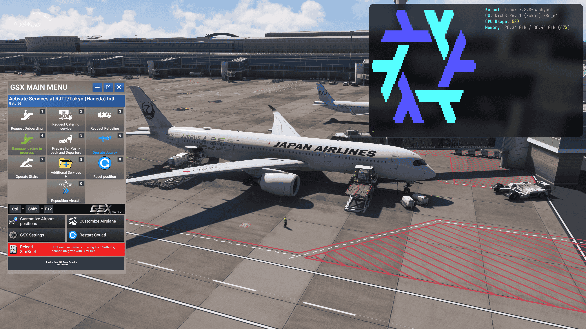

# GSX Pro / FSDT Addon Manager on Proton - findings & fix

## What this is

GSX Pro is FSDT's ground-services addon for MSFS 2024. Under Proton on Linux it does not
work: the installer does not deliver the GSX engine and reports no error, the license
check fails on Wine's incomplete .NET layer, and the engine exits before the in-sim GSX
menu is built.

GSX ships fixes as hotfix files: its updater downloads them, then copies them over the
installed product. Under Wine the download happens and the copy step does not, so the
files sit in the prefix unused.

`apply.sh` applies the fix and is idempotent. On a fresh install you run it twice: after
the installer, and again after the hotfix files are downloaded, since the copy step has
to be done by hand. `docs/internals.md` covers what breaks and
why, `docs/manual-steps.md` is the same procedure by hand, and `docs/upstream.md` lists
what FSDT could change so none of this is needed.

_Note:_ No license check is bypassed. The installer, the updater and the FSDT license
flow run unmodified, and a genuine GSX Pro purchase is still required; the Mono patch
only fixes Wine's COM registration so the product's own license check can complete on
Linux. The repo contains no Microsoft or FSDT files - every payload is downloaded from
official sources under your own FSDT account.

## Tested tools

Works: **Proton-Cachyos** 11.0-20261005 (wine-mono 11.3.0).

Does not work: GE-Proton. `apply.sh` reads the compatibility tool's location from
`compatdata/<appid>/config_info`, then looks for its Mono at
`<tool>/files/share/wine/mono/wine-mono` or the newest `wine-mono-*` beside it, and
stops with `no wine-mono under <tool>` when neither has a `lib/mono/4.5`. GE-Proton
keeps its Mono elsewhere, so the script stops before it patches anything. Whether it
could be made to work has not been investigated.

## Proof

Proof that this fix actually works and isn't *just* AI slop:



## What you need

- Linux with Steam (Flatpak or regular), MSFS 2024 installed and launched at least once.
  The app id is **2537590**; `protontricks` lists it if you don't know.
- A GSX Pro purchase. Download `FSDT_Universal_Installer.exe` from your FSDT account.
- `protontricks` (Flatpak or pip) - runs everything inside the game's prefix.

- No .NET Framework install. Do not run `winetricks dotnet48`: the engine's .NET 4.x COM
  calls are served by the patched Wine Mono, and `apply.sh` only sets the win10 bottle. See
  [`docs/internals.md`](docs/internals.md#net-runtime-for-the-engines-com-components).
- `curl`, `python3` (zip extraction uses `zipfile`; `unzip` is not required), and
  `python3` + `dnfile` for `gen_reg.py`. That script creates a venv under the prefix's
  `drive_c/gsxfix/pyenv` and pip-installs `dnfile` when the system python lacks it.

- Confirmed working: GSX Pro content package **4.0.23**, engine payload CPython **3.7.9**
  with wxPython **3.2.3**, and WebView2 runtime **152.0.4191.66** in the prefix. FSDT's
  own binaries carry no version resource, so the Addon Manager build is not recorded;
  nothing in `apply.sh` depends on it.

## Simple instructions

Open a terminal in this folder and run:

```bash
# Prefix location - use the line matching your Steam install:
# Flatpak Steam:
PFX="$HOME/.var/app/com.valvesoftware.Steam/data/Steam/steamapps/compatdata/2537590/pfx"
# Regular Steam:
# PFX="$HOME/.local/share/Steam/steamapps/compatdata/2537590/pfx"

# 1. Install the FSDT Addon Manager.
#    The installer opens the Addon Manager window when it finishes; close it, it
#    cannot work yet. The regasm error it reports is expected: apply.sh registers the
#    license library in the next step.
protontricks-launch --appid 2537590 ~/Downloads/FSDT_Universal_Installer.exe

# 2. Apply the fix (first pass. "no hotfix_pending.json yet" is expected: that manifest
#    is written when the Addon Manager stages hotfix files, which happens in step 4)
./apply.sh 2537590

# 3. Open the Addon Manager GUI. /INSTALLMODE is required - without it the updater does
#    not open a GUI.
#    Activate your license and install the GSX products (~13 GB download). Install
#    should finish without errors. Close the GUI afterwards.
protontricks-launch --appid 2537590 \
  "$PFX/drive_c/Program Files (x86)/Addon Manager/Couatl_Updater2.exe" /INSTALLMODE

# 4. Launch MSFS 2024 from Steam, reach the main menu, then quit. The Couatl entry in
#    the sim's exe.xml (prefix: AppData/Roaming/Microsoft Flight Simulator
#    2024/exe.xml) starts couatl64_boot.exe, which downloads the hotfix files into
#    AppData/Roaming/Virtuali/ and leaves them staged. Running the boot exe directly
#    should avoid the sim run; not tested:
#    protontricks-launch --appid 2537590 \
#      "$PFX/drive_c/Program Files (x86)/Addon Manager/couatl64/couatl64_boot.exe"

# 5. Apply the fix again - applies the hotfix files, ensures the Community
#    package links are valid, installs wxPython.
./apply.sh 2537590

# 6. Launch MSFS 2024 from Steam - GSX works
```

If a Proton update breaks GSX again, re-run `./apply.sh 2537590`.

## When you need to run it again

- The Mono patch lives in the Proton compatibility tool (its bundled wine-mono), not in
  the prefix. Reapply after a compatibility-tool update, after switching tools
  (Experimental or another Proton version; GE-Proton does not work, see *Tested tools*),
  or when Steam re-downloads the tool. GSX updates, sim updates and hotfixes do not
  touch it.
- Registry entries, engine files, the .NET runtime and the exe.xml entry live in the
  prefix: they survive sim and GSX updates, and only need redoing if
  `compatdata/<appid>` is wiped.
- Re-run `apply.sh` after any compatibility-tool change; already-applied steps skip. The
  patcher targets wine-mono method names and checks that the output references WineCompat,
  so a wine-mono version bump stops the script instead of patching part of it.

## Gotchas

- `hotfix_pending.json` stays `"pending"` after manual apply; boot logs
  "Hotfix already pending, skipping check" - harmless, files are already in place.
- The hotfix zips are split archives (`.zip.001`); current releases have single parts.
- `Error could not convert string to float: 'Name:"Nosewheel"'` in Couatl.err is a
  contact_points parse warning from some aircraft presets. It is not fatal.
- Flatpak Steam: the prefix lives at
  `~/.var/app/com.valvesoftware.Steam/data/Steam/steamapps/compatdata/<appid>/pfx`;
  protontricks handles Flatpak transparently (`protontricks-launch --appid <id> <exe>`).
- The installer rewrites `exe.xml` and leaves `exe_backup_fsdt.xml` next to it.

## Did it work?

The GSX menu loads in-sim, the engine survives the full load, and `Couatl.err` shows
normal aircraft parsing. With the sim running the engine connects and logs `ATC_ID_SIM
read from Simconnect is <registration>`, then parses livery, aircraft.cfg and gsx.cfg.

Applying the fixes one at a time, `Couatl.err` progresses: abort at 0.046 s
(`Python error {}`) → `No module named 'wx'` → stable idle without the sim →
`No module named 'wx.svg'` → clean.

## Deep dives

- `docs/internals.md` - symptom chain, root causes, installer-related fixes, prefix user trees, SimConnect transport
- `docs/manual-steps.md` - what `apply.sh` does, step by step, for doing it by hand
- `docs/upstream.md` - changes FSDT / Virtuali could make so none of this is needed
